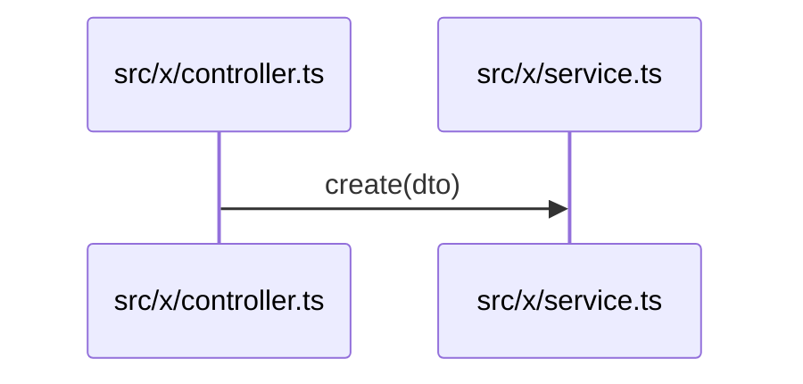

# <TASK ID> — Design (max 150 lines)

Mode: guided ClickUp/Jira | authorized GitHub issue
Source: <task or issue URL>
Context read: `_project/INDEX.md`, `_project/architecture.md`, `_project/codemap.md` (generated at <commit>)
Rules: R-xx, R-yy (from `_project/business-rules.md`)

## 1. Problem and acceptance criteria

- Current behavior:
- Desired behavior:
- AC-1: <criterion> — acceptance test: `<test file>#<test name>`
- AC-2:

Each AC becomes a failing acceptance test before any code; done = all AC tests pass.
- Edge cases:

## 2. Flow

One Mermaid diagram of the end-to-end path. Participants and calls must be real symbols from `codemap.md`, written `path/file.ts#symbol`. Mark new symbols `(new)`.

## 3. Files and TDD tasks

| # | AC | File (`codemap.md` path or `(new)`) | Failing test first | Verification | Status |
| --- | --- | --- | --- | --- | --- |
| 0 | all | test files | AC acceptance tests, all red | test run shows each AC failing | pending |
| 1 | AC-1 | | | | pending |

Evidence: API → curl/client with synthetic data; UI → visible flow, screenshots, console/network. AWS: not allowed | read-only, see `sdlc/SDLC.md#safety-rules`.

## 4. Out of scope

-

## Promote at the end (fill before closing)

- New/changed rules → `business-rules.md`:
- Decisions → `decisions.md`:
- BTW found → `INDEX.md` or issue:
