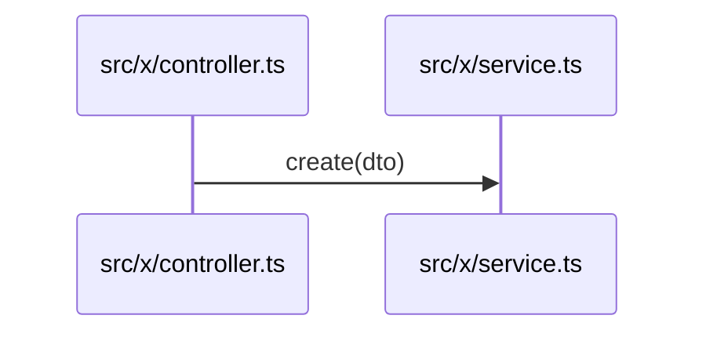

# <TASK ID> — Design (max 150 lines)

Type: bug | feature (from `sdlc-intake`)
Mode: guided | auto (implementation mode, chosen at intake; see `sdlc/SDLC.md#implementation-modes`)
Flow: ClickUp/Jira | authorized GitHub issue
Source: <task or issue URL>
Context read: `_project/INDEX.md`, `_project/architecture.md`, `_project/codemap.md` (generated at <commit>)
Rules: R-xx, R-yy (from `_project/business-rules.md`)

## 1. Problem and acceptance criteria

- Current behavior:
- Desired behavior:
- AC-1: <criterion> — acceptance test: `<test file>#<test name>` — verify: <command | page | file> → <expected result>
- AC-2:

Each AC gets an acceptance test written after the production change, against its "verify" line; done = all AC tests pass. "Verify" is how someone with only the repo checks the AC: a command to run, a page and what it should show, or a file that should contain something, plus the expected result.
- Edge cases:

## 2. Solution options and trade-offs

| Option | Pros | Cons | Chosen |
| --- | --- | --- | --- |
| A | | | ✓ — why |
| B | | | |

## 3. Flow

One Mermaid diagram of the end-to-end path. Participants and calls must be real symbols from `codemap.md`, written `path/file.ts#symbol`. Mark new symbols `(new)`.

## 4. Files and tasks

| # | AC | File (`codemap.md` path or `(new)`) | Test (written after the change) | How to verify (command / page / file + expected result) | Status |
| --- | --- | --- | --- | --- | --- |
| 1 | AC-1 | | | | pending |

Evidence: API → curl/client with synthetic data; UI → visible flow, screenshots, console/network. AWS: not allowed | read-only, see `sdlc/SDLC.md#safety-rules`.

## 5. Out of scope

-

## Promote at the end (fill before closing)

- New/changed rules → `business-rules.md`:
- Decisions → `decisions.md`:
- BTW found → `INDEX.md` or issue:
